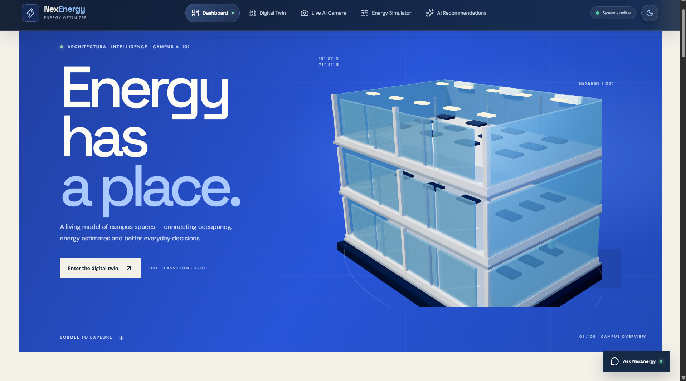
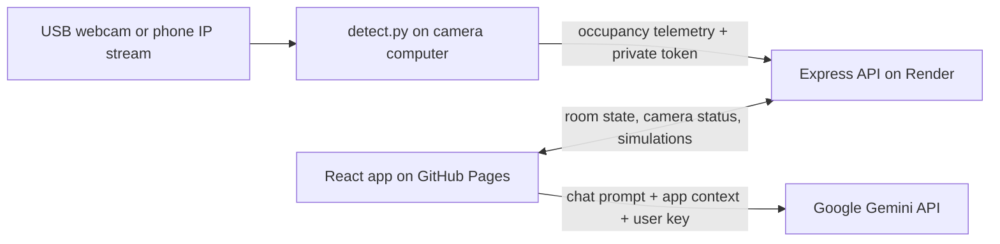

# NexEnergy — Smart Campus Energy Optimizer

[](https://github.com/Rishabh-12/code-cash/actions/workflows/deploy-pages.yml)

**Live demo:** [Open NexEnergy](https://rishabh-12.github.io/code-cash/) · **Source:** [Rishabh-12/code-cash](https://github.com/Rishabh-12/code-cash)

NexEnergy is a campus energy-optimization demo. It combines an animated three-floor digital twin, classroom occupancy, energy scenario modeling, computer vision, recommendations, and an optional Gemini chat assistant.

> **Demo and estimates:** This app does not read utility meters or control real building equipment. Energy, cost, carbon, and savings are estimates based on the assumptions below. Camera vision reports people only. Use the live room connection for a controlled demo, not as a safety or building-control system.

## Visual tour

<p align="center">
  
</p>

<p align="center"><strong>Explore the dashboard, Digital Twin, room controls, simulator, and recommendations in the <a href="docs/PROJECT_SHOWCASE.md">NexEnergy visual tour</a>.</strong></p>

The [feature guide and recording timeline](docs/PROJECT_FEATURES_AND_VIDEO_TIMELINE.txt) explains the project modules and calls out where each feature appears in the supplied demo videos.

## Get started

### Use the hosted app

Open the [live demo](https://rishabh-12.github.io/code-cash/). The frontend is hosted on GitHub Pages and reads shared room state from the NexEnergy API on Render. If the API is asleep, its first request can take a little longer. If it is unavailable, the app shows local sample data and keeps the interface usable.

### Run the app locally

Requirements: Node.js 20 or newer and npm.

```bash
git clone https://github.com/Rishabh-12/code-cash.git
cd code-cash
npm install
npm run dev
```

Open the local address printed in the terminal (normally `http://localhost:3000`). In development, Express starts Vite and serves its API on the same origin, so the app works locally without extra environment settings. To use the shared online API instead, set `VITE_API_URL` before starting the server:

```powershell
$env:VITE_API_URL = "https://campusiq-api-tskc.onrender.com"
npm run dev
```

For a production build, run `npm run build`. To serve the built app and API together locally in PowerShell:

```powershell
npm run build
$env:NODE_ENV = "production"
npm start
```

## What’s in the app

- **Dashboard:** campus overview, modeled energy and savings, recent event timeline, and a three-floor building visual.
- **Digital Twin:** selectable floors and rooms, occupancy profiles, equipment status, and classroom inspection. The building contains nine modeled spaces; the current hosted API shares one live room-state record for A-101, while other room profiles remain illustrative.
- **Live AI Camera:** browser camera person detection over HTTPS, or occupancy updates from the local YOLO camera agent. It shows occupancy and empty-room status; it does not measure electrical usage.
- **Energy Simulator:** adjust a modeled room’s occupancy, lights, AC units, temperature setpoint, and operating hours; compare estimated baseline and scenario results.
- **AI Recommendations:** actionable rule-based suggestions based on current modeled room and simulation state.
- **NexEnergy chat:** optional Gemini assistant. Add your own Google AI Studio API key in the chat settings. The key stays in that browser tab’s `sessionStorage` and is sent directly to Google’s Gemini API.
- **Theme and motion:** light/dark themes, animated charts, cursor-responsive building artwork, and scroll-driven storytelling.

## How the system works



The full architecture, data flow, assumptions, API routes, and limitations are in [docs/ARCHITECTURE.md](docs/ARCHITECTURE.md). Camera setup and troubleshooting are in [docs/CAMERA_SETUP.md](docs/CAMERA_SETUP.md). The detailed [project features and screen-recording timeline](docs/PROJECT_FEATURES_AND_VIDEO_TIMELINE.txt) documents the demo flow and timestamps for each supplied video.

### Energy model used by this demo

The baseline classroom assumptions are 400 W for all ten modeled lights and 1,800 W for all three modeled AC units. The app prorates those loads when individual units are toggled.

```text
estimated kWh = (modeled lighting watts + modeled AC watts) × hours ÷ 1,000
estimated cost = estimated kWh × ₹8
estimated CO₂ = estimated kWh × 0.82 kg
```

These are illustrative constants in `src/services/energyCalculations.js` and `server.ts`; adjust them to local equipment specifications and tariffs before using the numbers for planning. The historical chart data is sample data. Camera occupancy can influence room state and recommendations, but it does not change the energy calculation into a meter reading.

## Local YOLO camera agent (optional)

`detect.py` runs on the computer that can access the webcam or phone stream. It uses Ultralytics YOLOv8 to detect and track the **person** class only, smooths occupancy updates, and sends counts and telemetry to the Render API. Video frames are processed on that computer; the agent sends JSON telemetry, not camera images. The `yolov8n.pt` model is downloaded by Ultralytics on first run and is ignored by Git.

For the full Windows steps, environment variables, phone-stream setup, security notes, and common fixes, follow [Camera setup](docs/CAMERA_SETUP.md). In brief:

1. Install Python 3.10 or newer and the packages in `requirements-vision.txt`.
2. Create a private token and set it as `CAMERA_INGEST_TOKEN` in the Render service environment.
3. Set `BACKEND_URL` and the same `CAMERA_INGEST_TOKEN` in the PowerShell window running `detect.py`.
4. Start `py detect.py`, choose a webcam or phone stream, and keep the process running.

Never commit a real token, Gemini key, camera image, or model weight to this repository. The current token is configured privately in Render; it is intentionally not included in the repository.

## Deployment

The project uses two hosted services:

| Part | Host | Address | Deploys from |
| --- | --- | --- | --- |
| Frontend | GitHub Pages | [rishabh-12.github.io/code-cash](https://rishabh-12.github.io/code-cash/) | GitHub Actions after changes to the frontend/workflow paths on `main` |
| API | Render web service | [campusiq-api-tskc.onrender.com](https://campusiq-api-tskc.onrender.com/api/health) | Render auto-deploy from `main` using [`render.yaml`](render.yaml) |

The Pages workflow sets `VITE_API_URL` to the Render API and `VITE_BASE_PATH` to `/code-cash/`, builds `dist/`, and publishes it. Render installs development dependencies for the Vite build, builds the app, and starts the Express server. The API health check is `/api/health`.

### Render configuration

The Blueprint in `render.yaml` declares the Node web service, build/start commands, health path, production environment, frontend CORS origin, and a secret `CAMERA_INGEST_TOKEN` (`sync: false`). On a new Render setup, create the service from the repository’s Blueprint and provide a fresh private token when prompted. Do not paste secrets into `render.yaml` or GitHub.

### Release and project history

See [CHANGELOG.md](CHANGELOG.md) for notable changes and release notes. See [CONTRIBUTING.md](CONTRIBUTING.md) for development and change guidance. Version tags and GitHub Releases should be created when a reviewed submission snapshot is ready.

## API overview

All routes are served by the Render API base URL:

| Route | Method | Purpose |
| --- | --- | --- |
| `/api/health` | GET | Service status and configuration readiness (never returns secrets) |
| `/room-state` | GET | Shared modeled state for the connected A-101 room |
| `/update-occupancy` | POST | Update occupancy/equipment telemetry; Python agent requests require `X-Camera-Token` |
| `/camera/status` | GET | Current camera activity, occupancy, alerts, and estimate |
| `/camera/start` · `/camera/stop` | POST | Mark the browser camera source active/inactive |
| `/simulate` | POST | Calculate baseline vs. scenario energy and savings from appliance assumptions |
| `/calculate-multiple` | POST | Calculate modeled energy and cost breakdown |
| `/historical-data` | GET | Return the demo’s sample historical series |
| `/api/recommendations` | POST | Return rule-based recommendations for the supplied scenario |
| `/generate-insight` | POST | Return a context-based backend insight/fallback |

## Stack and repository layout

- React 19, Vite 6, TypeScript, Tailwind CSS 4, Recharts, Three.js
- Express 5 API, served by `server.ts`
- Browser vision with TensorFlow.js/Coco-SSD; optional local YOLOv8, OpenCV, and Python camera agent
- Optional Gemini API calls from the browser

```text
src/                         React app, pages, components, styles, services
  Components/                Dashboard, Digital Twin, camera, simulator, chat
  services/api.js            API client and local fallback behavior
  services/energyCalculations.js  Shared front-end energy assumptions
server.ts                    Express API and development/production server
detect.py                    Optional local YOLO person-detection agent
requirements-vision.txt      Python camera-agent dependencies
render.yaml                  Render API service Blueprint
.github/workflows/           GitHub Pages build and deploy workflow
docs/                        Architecture and camera setup guides
```

## Troubleshooting

- **Site opens but shows offline/sample state:** check the [API health endpoint](https://campusiq-api-tskc.onrender.com/api/health). If Render’s free instance was idle, wait for it to wake and reload.
- **Pages shows an old version:** check the [GitHub Actions deployment](https://github.com/Rishabh-12/code-cash/actions/workflows/deploy-pages.yml); wait until the latest `main` run succeeds, then hard-refresh the page.
- **Render build says it cannot find `@vitejs/plugin-react`:** make sure the Render install command includes dev dependencies. The repository’s Blueprint sets `npm install --include=dev` and `NPM_CONFIG_INCLUDE=dev`.
- **Python camera gets 401:** the `CAMERA_INGEST_TOKEN` in the current PowerShell session must exactly match the private Render value; restart the script after correcting it.
- **Python camera gets 503:** set a private `CAMERA_INGEST_TOKEN` in the Render service environment and wait for its redeploy to finish.
- **Camera cannot open:** confirm Windows camera permission, close other apps using the webcam, or check the phone camera URL, same-network connection, and firewall rules.
- **Gemini chat uses its local assistant/fallback:** add a valid Gemini key in chat settings. It is per-tab and is cleared when the tab session ends.

## Important limitations

- The API currently keeps room and camera state in process memory; a restart clears it. The demo does not use a persistent database.
- Only A-101 has a shared API-backed room record. Other floor/room values and the historical series are illustrative profiles.
- Vision counts people. It does not identify users, detect phones, verify power use, or operate real AC/light hardware.
- The camera agent requires local camera access and a network path to Render. The hosted API cannot open a webcam connected to your laptop by itself.
- These endpoints and estimates are intended for a hackathon/demo. Add authentication, persistence, privacy controls, calibrated equipment data, and operational safeguards before any production campus deployment.
