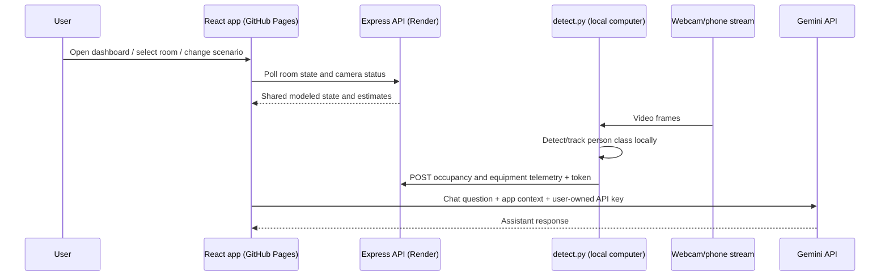

# NexEnergy architecture and data flow

## Hosted components

| Component | Implementation | Responsibility |
| --- | --- | --- |
| Frontend | React/Vite, GitHub Pages | Dashboard, 3D digital twin, browser camera, simulator, recommendations, charts, chat UI |
| API | Express in `server.ts`, Render | Shared A-101 room/camera state, energy calculations, recommendation and insight responses |
| Python camera agent | `detect.py`, runs locally | Reads a webcam/phone IP stream, detects/tracks people with YOLOv8, posts count telemetry |
| Generative AI | Google Gemini API, optional | Answers chat prompts using current UI telemetry and recent conversation context |



## Frontend behavior

`src/App.jsx` owns the primary modeled room and page state. `src/services/api.js` sends requests to `VITE_API_URL` (or an optional user-configured URL) and falls back to local sample state when the network/API is unavailable. UI state therefore remains usable in a local preview, but the app indicates whether it is connected to the shared API.

The building visual describes three floors and nine rooms. Most room profiles are client-side illustrative profiles; the hosted API currently maintains one process-wide A-101 room state. Selecting or simulating another room does not create a separate persistent backend record.

The browser camera runs its vision model in the browser and sends occupancy telemetry. The optional Python agent is a separate camera path: it runs on a computer with camera access and sends periodic JSON updates to the API.

## Backend behavior

`server.ts` serves the JSON API, the Vite middleware during development, and `dist/` static files when `NODE_ENV=production`. Render sets the port through `PORT`; the server listens on `0.0.0.0`.

Room state, camera state, and sample historical records are held in memory in the running Node process. They reset after a restart or deploy and are not a database. The occupancy endpoint clamps the reported count to the modeled classroom capacity of 12. For requests whose `source` is `python-yolo`, the server requires the `X-Camera-Token` header to match `CAMERA_INGEST_TOKEN`; browser vision uses the existing app path.

## Energy and savings calculations

Shared constants are in `src/services/energyCalculations.js` and mirrored by the server:

| Assumption | Value |
| --- | ---: |
| Classroom lights | 400 W total across 10 modeled lights (40 W each) |
| Classroom AC | 1,800 W total across 3 modeled units (600 W each) |
| Example tariff | ₹8 per kWh |
| Example carbon factor | 0.82 kg CO₂ per kWh |

For any selected scenario:

```text
load_W = enabled_light_count × 40 + enabled_AC_count × 600
energy_kWh = load_W × operating_hours ÷ 1,000
cost_Rs = energy_kWh × 8
carbon_kg = energy_kWh × 0.82
saved_kWh = max(0, baseline_kWh − scenario_kWh)
```

The model does not currently account for measured HVAC draw, weather, actual occupancy-to-load relationships, demand charges, or real-time utility tariffs. The UI and API return estimates, not meter data. The dashboard’s historical series is fixed sample data.

## Generative and rule-based assistance

Recommendations are produced by deterministic rules in the frontend fallback or API endpoint `/api/recommendations`. The backend insight endpoint (`/generate-insight`) also has a rule-based response; it does not call a hosted Gemini model. The separate chat assistant calls Gemini directly from the browser when the user provides a key. It builds a prompt with current application context, keeps the key in tab-scoped `sessionStorage`, and sends the request to Google. If no key is present or the request fails, the chat uses its local fallback response.

## API route reference

Base URL: `https://campusiq-api-tskc.onrender.com`.

| Method | Path | Description |
| --- | --- | --- |
| GET | `/api/health` | Health and readiness flags; does not disclose the camera token |
| GET | `/api/sync-info` | App/repository sync metadata |
| GET | `/room-state`, `/api/room-state` | Current A-101 modeled room state |
| POST | `/update-occupancy`, `/api/update-occupancy` | Update occupancy/equipment state and return an estimate |
| POST | `/simulate`, `/api/simulate` | Baseline and scenario energy/savings calculation |
| POST | `/calculate-multiple`, `/api/calculate-multiple` | Per-appliance energy and cost breakdown |
| GET | `/historical-data`, `/api/historical-data` | Sample time series for dashboard charts |
| POST | `/api/recommendations` | Rule-based recommendations for the submitted context |
| POST | `/generate-insight`, `/api/generate-insight` | Rule-based natural-language room insight |
| GET | `/camera/status` | Camera freshness, occupancy, and modeled energy estimate |
| POST | `/camera/start`, `/camera/stop` | Mark a browser camera session active or stopped |
| POST | `/camera/mobile-frame` | Deprecated raw-frame endpoint; returns HTTP 410 |

The Python agent posts to `/update-occupancy` with JSON fields including `source`, `occupancy_count`, `empty_seconds`, `lights_on`, `ac_on`, `fps`, and `inference_ms`. It includes `X-Camera-Token` for authentication.

## Deployment path

1. A push to `main` that changes one of the configured frontend paths triggers `.github/workflows/deploy-pages.yml`.
2. GitHub Actions installs Node packages, builds the app with the Render API URL and `/code-cash/` base path, and publishes `dist/` to GitHub Pages.
3. Render auto-deploys the Node API from `main` using `render.yaml`, builds Vite with its dev dependencies available, and starts `server.ts`.
4. Render checks `/api/health`. The private `CAMERA_INGEST_TOKEN` is configured as a Render environment secret, not committed to Git.

## Security and production scope

- Keep the camera token and Gemini API keys out of source files, screenshots, commit messages, and issue reports.
- CORS limits browser origins but is not user authentication. Python occupancy ingestion has a shared token; other demo endpoints are not a complete authenticated campus API.
- Do not send personally identifying or sensitive video through this demo. The Python agent processes frames locally and posts counts; the UI/browser vision path processes camera data in the browser.
- Before real deployment, add user/service authentication, persistent storage, per-room authorization, rate limiting, privacy/retention controls, calibrated energy telemetry, monitoring, and hardware safety controls.
