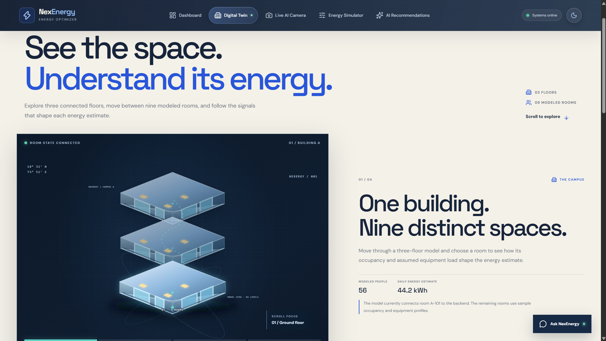
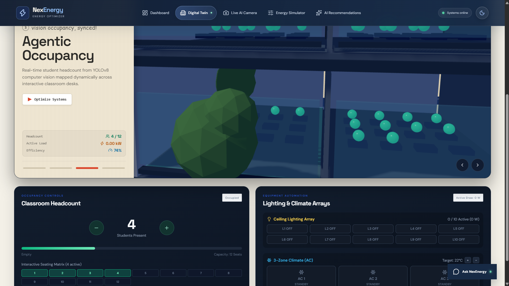
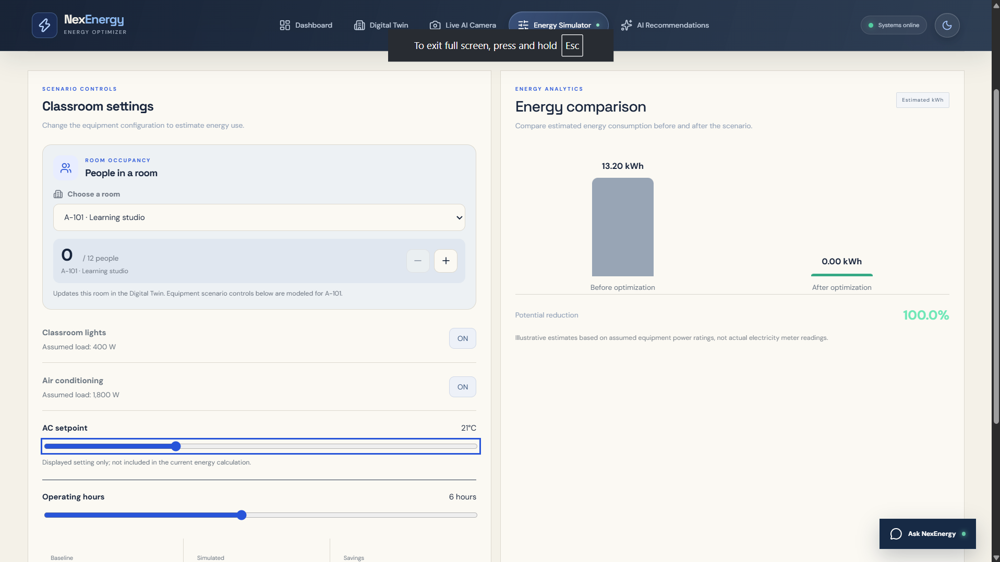
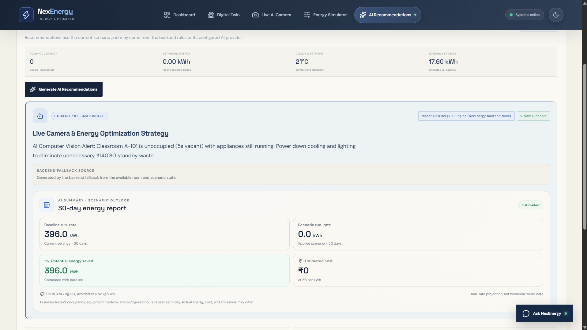

# NexEnergy | Visual tour

**A campus energy-optimization demo, from the building overview to room-level decisions.**

[Open the live demo](https://rishabh-12.github.io/code-cash/) · [Read the feature and video timeline](PROJECT_FEATURES_AND_VIDEO_TIMELINE.txt) · [Explore the source](https://github.com/Rishabh-12/code-cash)

  

<strong>Start with the campus.</strong> The dashboard pairs a cursor-responsive three-floor building with a clear route into the Digital Twin.

---

## Explore the product

| Building story | Interactive room |
| --- | --- |
|  |  |
| **Move through three floors and nine modeled spaces.** Scroll-led sections connect the building view to room context. | **Inspect the room state.** Adjust occupancy, ten modeled lights, three AC units, and the target temperature. |

| Scenario planning | Recommendations |
| --- | --- |
|  |  |
| **Compare a scenario.** Change modeled people, equipment, and operating hours, then review the animated energy comparison. | **Turn context into next steps.** Review recommendations and a 30-day run-rate projection based on the current scenario. |

---

## What the screens represent

- **Three floors, nine rooms:** A selectable visual model for navigating campus spaces.
- **Room-level controls:** A 12-desk seating plan, occupancy count, ten lights, three AC units, and temperature control.
- **Energy simulator:** A baseline and scenario comparison using assumed equipment loads and hours.
- **Recommendations:** Explainable suggestions from the available room and scenario state, with a monthly projection.
- **Connected A-101:** The current API shares the A-101 room state. The other room profiles are illustrative samples.

### Read the numbers as estimates

Energy, cost, carbon, and savings are modeled estimates, not meter readings. The app does not operate physical lights or air conditioners. See the [architecture guide](ARCHITECTURE.md) for the calculation assumptions and data flow.

### Screenshot selection

This gallery keeps five distinct screens and leaves out near-duplicate captures. The live-camera screenshot was not included because its preview contains identifiable people. The recommendations capture with the open chat panel was also omitted because it obscures the report.
